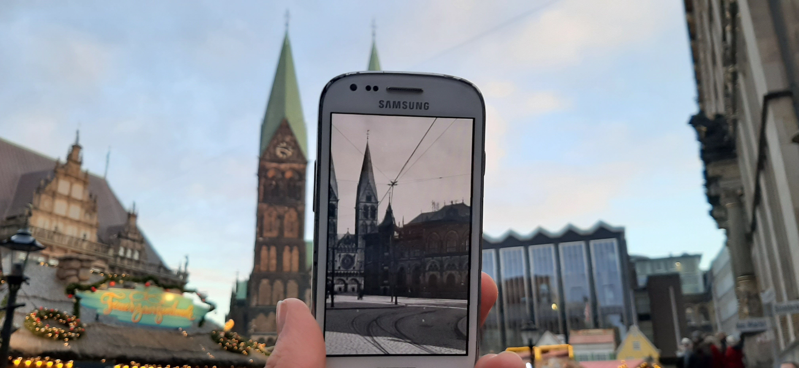

<!-- gcffm Listing Generator -->

 

<b>Bremen im Zeitwandel</b>

 
 

Moin, 
ich habe lange überlegt, wie und wo ich meinen Virtuell "verstecken" kann. Nun habe ich mich entschieden ihn hier in Bremen zu legen. 
Doch wo in Bremen? Ich habe mich entschieden, ihn direkt in der Innenstadt zu legen, damit viele die Möglichkeit haben, den Virtuell zu besuchen. Allerdings muss man nicht nur ein Foto machen. Aber schwer ist dieser Cache trotzdem nicht.

Bremen hat eine sehr bewegte Geschichte. Zudem hat Bremen einige interessante Sagen und Traditionen.

Ich glaube jeder kennt die Geschichte der Bremer Stadtmusikanten. Doch wer (außerhalb von Bremen) kennt z.B. die Sage der Bremer Gluckhenne?

<em>Der Legende nach fuhren einige freiheitsliebende Flussfischer mit ihren Familien auf der Flucht vor übelgesinnten Nachbarn die Weser entlang. Als ein Sturm aufzuziehen drohte, suchten sie verzweifelt nach einer Bleibe. Da entdeckten sie eine Henne mit ihren Küken, die am rechten Flussufer ein sicheres Plätzchen gefunden hatte. Die Fischer erkannten darin ein Zeichen, denn wo es einer Henne und ihren Küken gut gehe, da sollten doch auch sie gut und in Freiheit leben können, so dass sie sich niederließen und Bremen, "einen Hort der Freiheit" gründeten.</em> 
(Quelle: <a href="https://www.bremen.de/tourismus/sehenswuerdigkeiten/traditionen-originale-geschichten" target="_blank">Bremer Sagen und Traditionen</a>)

Es gibt noch eine Menge mehr solch' schöner Sagen rund um Bremen. Es lohnt sich dort mal rein zuschauen. 

<b>Eure Aufgaben um den Cache zu loggen:</b> 

<ol>
<li><b>Vergangenheit:</b> 
Vergleiche die Vergangenheit mit Heute: Mach ein "Früher vs Heute" Foto von einem beliebigen Ort in Bremen (es muss nicht unbedingt in der Alt- bzw. Innenstadt sein). Es sollte nur ein <b>Unterschied zwischen damals und heute</b> zu sehen sein. 
Suche dir ein <b>historisches Bild</b> von Bremen im Internet und begib dich an den Platz der Aufnahme. Fotografiere dieses Bild (via Handy oder ein gedrucktes Bild) so, dass es sich <b>ins neue Stadtbild</b> einpasst. (Siehe Beispiel Foto) 
<b>Wichtig:</b> Es geht <b>nicht</b> darum, die Bilder am PC ineinander zu schneiden oder das alte neben das neue Bild zu halten, sondern das Foto so ins Bild zu halten, dass das historische Foto, in eurem Bild das Motiv zum Teil überdeckt! 
<em>Bei meinem Beispiel wird die Bremer Bürgerschaft zum Teil von dem damaligem Gebäude überdeckt.</em> 
Lade das Foto in deinem Log hoch. 

<b>Beispiel:</b> 

</li>
<li><b>Gegenwart:</b> 
<ul>
<li>Stelle dich neben das Hanseatenkreuz und lade ein <a href="https://www.bremen.de/webcams" target="_blank">Webcambild</a> mit dir in deinem Log hoch. <em>Wenn gerade eine Veranstaltung ist (z.B. Freimarkt oder Weihnachtsmarkt), suche dir einen anderen Ort und markiere dich auf dem Bild</em> 
</li>
<li>Zähle die Zaunspitzen (auch die runden Spitzen) vom Zaun, der den Roland umgibt und sende eine E-Mail an <b>Zaunspitzen</b>.GC8920C@gmail.com wobei du natürlich 'Zaunspitzen' durch die Anzahl der Zaunspitzen ersetzt. Gebe als Betreff deine Nicknamen bzw. die Nicknamen von Eurem Team an (alle Nicknamen, nicht den Teamnamen) 
Zum Prüfen, um falsche Mails zu verhindern: Die einfache Quersumme der Zaunspitzen ist 12 (<b>nicht</b> 15)</li>
</ul>
</li>
<li><b>Aus einer anderen Welt:</b> 
Beschreibe in der E-Mail, wo du die Bremer Gluckhenne am Rathaus sehen kannst.</li>
<li><b>Optional:</b> 
Schreibe in <b>deinem Log</b>, welche Bremer Sage dir am Besten gefällt.</li>
</ol>

<b>Logs ohne Bilder und E-Mail muss ich leider Löschen.</b> 
Wenn du im Urlaub bist, musst du keinen Log á la "Gefunden, Log folgt später" schreiben. Dafür gibt es die Entwürfe/Drafts bzw. Feldnotizen/Fieldnotes!

 
Viel Spaß wünscht 
capoaira

 

<b>Für Bannerfreunde:</b> 
 
HTML-Quelltext: 
&lt;a href="https://coord.info/GC8920C" target="_blank"&gt;&lt;img src="https://raw.githubusercontent.com/capoaira/GC/master/img/GC8920C-Banner.gif"&gt;&lt;/a&gt;

 

 

 
<!-- ==================== Standart-Text der im Listing bleiben muss ========================= -->

<h4>Virtual Rewards 2.0 - 2019/2020</h4>

This Virtual Cache is part of a limited release of Virtuals created between June 4, 2019 and June 4, 2020. Only 4,000 cache owners were given the opportunity to hide a Virtual Cache. Learn more about Virtual Rewards 2.0 on the <a href="https://www.geocaching.com/blog/2019/05/introducing-virtual-rewards-2-0/">Geocaching Blog</a>.

